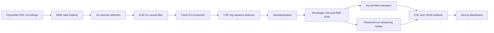

# NeuroStream BCI

An end-to-end motor-imagery brain-computer interface project that combines a reproducible EEG analysis pipeline with an interactive recorded-replay dashboard.

[](https://nextjs.org/)
[](https://react.dev/)
[](https://mne.tools/)
[](https://www.python.org/)

**[Open the live dashboard](https://motor-imagery-bci-signal-processing.vercel.app)** · **[View the executed notebook](assignment/bci_lab4_solution.ipynb)** · **[Read the technical report](assignment/results/BCI_Lab4_Summary_Report.pdf)**

> [!IMPORTANT]
> This is an educational research prototype based on recorded EEG. It is not a medical device, a diagnostic tool, or a live headset interface.

## Overview

The project processes public PhysioNet EEG Motor Movement/Imagery recordings, removes a calibrated frontal artifact component, extracts Common Spatial Pattern features, evaluates shrinkage LDA and RBF SVM classifiers, and replays a reserved recording through a causal streaming pipeline.

The accompanying web application turns the verified analysis artifacts into an explorable interface with synchronized EEG traces, motor-rhythm power, classifier output, latency measurements, CSP patterns, and an educational 3D brain view.

## Highlights

- **Reproducible signal pipeline:** 8-30 Hz causal filtering, ICA artifact mitigation, CSP feature extraction, scaling, and classification.
- **Leakage-aware evaluation:** CSP, scaling, and classifiers are fitted inside each validation fold; SVM tuning is nested.
- **Recorded streaming replay:** stateful filtering, a fixed ICA projection, 500 ms rolling windows, and three-decision majority voting.
- **Interactive EEG dashboard:** replay controls, speed selection, channel traces, C3/C4 mu-beta power, body cue, and latency telemetry.
- **Transparent result boundaries:** calibration, training, verified replay, and exploration-only recordings are labeled separately.
- **Local EDF preview:** users can inspect the first channels of an EDF/EDF+ file in the browser without uploading it to a server.
- **Reproducible artifacts:** the executed notebook, figures, CSV outputs, summary JSON, DOCX report, and PDF report are committed under `assignment/`.

## System Architecture



## Verified Results

The values below are loaded from [`assignment/results/summary.json`](assignment/results/summary.json). They are reported as observed; unmet targets are not hidden or replaced.

### Offline cross-validation

| Model | 10-fold OOF accuracy | ROC-AUC | Fold accuracy SD |
| --- | ---: | ---: | ---: |
| Shrinkage LDA | 56.7% | 0.604 | 27.4% |
| RBF SVM | 56.7% | 0.618 | 31.6% |

### Reserved-run replay

| Metric | Result |
| --- | ---: |
| Replay recording | Subject 1, Run 04 |
| Correlated-window accuracy | 77.0% |
| Trial-level majority vote | 15/15 trials |
| Idealized ITR | 7.23 bits/min |
| Mean processing latency | 0.445 ms |
| 95th-percentile latency | 0.565 ms |
| Maximum latency | 1.395 ms |
| Simulated queue drops | 0 |

The 15/15 trial result comes from one small reserved recording that was inspected during development. It is useful for demonstrating the replay system, but it is not evidence of subject-independent or clinical performance.

## Dataset and Experimental Split

The analysis uses the [EEG Motor Movement/Imagery Dataset](https://physionet.org/content/eegmmidb/1.0.0/) distributed through PhysioNet and MNE.

| Purpose | Recording(s) | Use |
| --- | --- | --- |
| ICA calibration | Subject 1, Runs 01 and 02 | Eyes-open and eyes-closed baselines |
| Classifier training | Subject 1, Runs 08 and 12 | Left-versus-right fist imagery |
| Streaming replay | Subject 1, Run 04 | Reserved causal replay and latency measurement |
| Exploration | Subjects 2 and 3 | Signal visualization only; no verified prediction claims |

The selected 16-channel montage includes frontal artifact proxies and central motor channels:

```text
Fp1 Fp2 F3 Fz F4 FC3 FCz FC4 C3 Cz C4 CP3 CPz CP4 P3 P4
```

## Dashboard

The dashboard provides:
